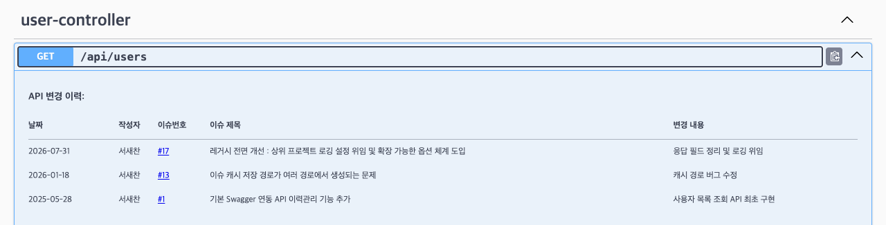

<div align="center">

# ⚡ SUH API Log

**API 변경 이력 문서화, 단 한 줄 어노테이션이면 끝**

<!-- 수정하지마세요 자동으로 동기화 됩니다 -->
<!-- AUTO-VERSION-SECTION: DO NOT EDIT MANUALLY -->
## 최신 버전 : v3.1.0 (2026-10-13)

[](https://nexus.suhsaechan.kr/#browse/browse:maven-releases:kr%2Fsuhsaechan%2Fsuh-api-log)
[](https://openjdk.org/)
[](https://spring.io/projects/spring-boot)
[](LICENSE.md)
[](https://jitpack.io/#Cassiiopeia/suh-api-log)
[](https://cassiiopeia.github.io/suh-api-log/)

[📚 문서 사이트](https://cassiiopeia.github.io/suh-api-log/) • [빠른 시작](#-빠른-시작) • [주요 기능](#-주요-기능) • [설정](#%EF%B8%8F-설정) • [CHANGELOG](CHANGELOG.md)

</div>

---

## ✨ 왜 SUH-API-LOG인가?

API 변경 이력을 직접 관리하려면 **문서 별도 작성, 버전 관리, 팀원 공유**까지 번거로운 작업이 필요합니다.
이 라이브러리는 모든 복잡함을 숨기고, **어노테이션 한 줄**로 API 변경 이력을 자동 문서화합니다.

| 기존 방식 | 이 라이브러리 |
|----------|--------------|
| 별도 문서에 변경 이력 수동 작성 | ✅ 코드 위에 어노테이션으로 선언 |
| 문서와 코드 동기화 누락 | ✅ 코드와 문서가 항상 일치 |
| GitHub 이슈 링크 수동 관리 | ✅ 이슈 번호만 적으면 자동 연동 |
| Swagger에 별도 설명 추가 | ✅ Swagger UI 자동 통합 |
| 외부 로깅 라이브러리 충돌 | ✅ 상위 프로젝트 로깅 설정에 완전 위임 (의존성 강제 없음) |

```java
@ApiLog(date = "2026-07-31", author = "서새찬", issueNumber = 17, description = "응답 필드 정리 및 로깅 위임")
@ApiLog(date = "2025-05-28", author = "서새찬", issueNumber = 1, description = "사용자 목록 조회 API 최초 구현")
@GetMapping("/api/users")
public List<User> getUsers() { ... }
```

⬇️ Swagger UI에 이렇게 나타납니다 (이슈 제목은 GitHub에서 자동으로 가져옴)



> 위 화면은 [`examples/demo`](examples/demo) 앱을 실제로 띄워 찍은 것입니다. `./gradlew -p examples/demo bootRun`으로 직접 확인할 수 있습니다.

---

## 🚀 빠른 시작

### 1. 의존성 추가 (JitPack)

GitHub 태그로 바로 받습니다. 별도 계정이나 설정이 필요 없습니다.

**Gradle (build.gradle)**
```groovy
repositories {
    mavenCentral()
    maven { url 'https://jitpack.io' }
}

dependencies {
    implementation 'com.github.Cassiiopeia:suh-api-log:v3.1.0'
    // Swagger UI 통합을 쓴다면 springdoc 을 직접 선언 (Boot 3 → 2.x, Boot 4 → 3.x)
    implementation 'org.springdoc:springdoc-openapi-starter-webmvc-ui:2.9.1'
}
```

**Maven (pom.xml)**
```xml
<repositories>
    <repository>
        <id>jitpack.io</id>
        <url>https://jitpack.io</url>
    </repository>
</repositories>

<dependency>
    <groupId>com.github.Cassiiopeia</groupId>
    <artifactId>suh-api-log</artifactId>
    <version>v3.1.0</version>
</dependency>
```

<details>
<summary>SUH Nexus 저장소로 받기</summary>

```groovy
repositories {
    mavenCentral()
    maven { url 'https://nexus.suhsaechan.kr/repository/maven-releases/' }
}

dependencies {
    implementation 'kr.suhsaechan:suh-api-log:3.1.0'
}
```

</details>

> 최신 버전은 위 JitPack 배지나 [Releases](https://github.com/Cassiiopeia/suh-api-log/releases)에서 확인하세요.

### 2. 이슈 연동 켜기 (선택)

```yaml
suhapilog:
  github:
    base-url: "https://github.com/{owner}/{repo}/issues/"
```

### 3. 바로 사용

```java
@ApiLog(date = "2024-12-20", author = "서새찬", issueNumber = 42, description = "사용자 목록 조회 API 추가")
@GetMapping("/api/users")
public List<User> getUsers() { return userService.findAll(); }
```

**끝!** Spring Boot Auto Configuration으로 별도 설정 없이 바로 사용 가능합니다.

---

## 🎯 주요 기능

### 📝 API 변경 이력 문서화
코드 레벨에서 **변경사항 추적**, 날짜·작성자·설명을 구조화된 형태로 관리

### 🔗 GitHub 이슈 자동 연동
이슈 번호만 적으면 **자동으로 GitHub에서 제목 조회**, 로컬 JSON 캐싱으로 네트워크 호출 최소화

### 📊 Swagger UI 통합
SpringDoc OpenAPI 자동 감지, API 문서에 **변경 이력 테이블 자동 생성**

### 🎨 상위 로깅 설정에 완전 위임
로깅 구현체를 **하나도 강제하지 않고**, 상위 프로젝트의 log4j2/logback 설정을 그대로 따름
(SLF4J → Log4j2 → JUL 순으로 런타임 자동 탐지)

### 🧩 모든 것이 교체 가능
이슈 조회·저장소·렌더러·제목 정제 **4개 확장점**, 빈 하나만 등록하면 동작이 바뀜

---

## 📖 API 레퍼런스

### @ApiLog

| 필드 | 타입 | 기본값 | 설명 |
|------|------|--------|------|
| `date` | String | (필수) | 변경 날짜 (YYYY-MM-DD 형식 권장) |
| `author` | String | (필수) | 작성자 이름 |
| `description` | String | (필수) | 변경 내용 설명 |
| `issueNumber` | int | -1 | GitHub 이슈 번호 (-1이면 링크 미표시) |

> 💡 **@Repeatable 지원**: `@ApiLog`는 중첩 없이 여러 개 반복 사용 가능합니다!

### 사용 예시

**단일 변경 이력**
```java
@ApiLog(date = "2024-12-20", author = "서새찬", issueNumber = 42, description = "사용자 조회 API 추가")
@GetMapping("/api/users")
public List<User> getUsers() { ... }
```

**여러 변경 이력 (한 줄 스타일)**
```java
@ApiLog(date = "2024-12-20", author = "김개발", issueNumber = 52, description = "응답 속도 50% 개선")
@ApiLog(date = "2024-12-15", author = "이설계", issueNumber = 48, description = "페이징 파라미터 추가")
@ApiLog(date = "2024-12-01", author = "서새찬", issueNumber = 42, description = "API 최초 구현")
@GetMapping("/api/users")
public List<User> getUsers() { ... }
```

**여러 변경 이력 (줄바꿈 스타일)**
```java
@ApiLog(
    date = "2024-12-20",
    author = "김개발",
    issueNumber = 52,
    description = "응답 속도 50% 개선"
)
@ApiLog(
    date = "2024-12-15",
    author = "이설계",
    issueNumber = 48,
    description = "페이징 파라미터 추가"
)
@GetMapping("/api/users")
public List<User> getUsers() { ... }
```

**GitHub 이슈 없이 사용**
```java
@ApiLog(date = "2024-12-20", author = "서새찬", description = "내부 리팩토링")
```

---

## ⚙️ 설정

아무것도 설정하지 않아도 동작합니다. `base-url`만 넣으면 이슈 연동이 켜집니다.

```yaml
suhapilog:
  github:
    base-url: "https://github.com/username/repository/issues/"
```

### 전체 옵션

**기본**

| 설정 | 타입 | 기본값 | 설명 |
|------|------|--------|------|
| `suhapilog.enabled` | boolean | `true` | 라이브러리 전체 활성화 여부 |
| `suhapilog.default-author` | String | `""` | `@ApiLog`의 `author`가 비었을 때 쓸 기본 작성자 |
| `suhapilog.storage.path` | String | `./github-issues` | 이슈 캐시 저장 경로 |

**로깅** — 전부 미설정이면 상위 프로젝트의 log4j2/logback 설정을 그대로 따릅니다.

| 설정 | 타입 | 기본값 | 설명 |
|------|------|--------|------|
| `suhapilog.logging.enabled` | boolean | `true` | `false`면 이 라이브러리 로그를 전면 차단 |
| `suhapilog.logging.level` | String | *(없음)* | `trace`/`debug`/`info`/`warn`/`error`. 상위가 허용한 범위를 **좁히기만** 합니다 |
| `suhapilog.logging.backend` | String | `auto` | `auto`/`slf4j`/`log4j2`/`jul`/`none` 강제 지정 |

**GitHub 이슈 조회**

| 설정 | 타입 | 기본값 | 설명 |
|------|------|--------|------|
| `suhapilog.github.base-url` | String | *(없음)* | 이슈 기본 URL. 미설정 시 이슈 연동만 꺼지고 나머지는 동작 |
| `suhapilog.github.timeout` | Duration | `5s` | 이슈 페이지 조회 총 타임아웃 |
| `suhapilog.github.user-agent` | String | `suh-api-log/{version}` | 스크래핑 차단 회피용 |
| `suhapilog.github.concurrency` | int | `4` | 부팅 시 병렬 조회 스레드 수 |
| `suhapilog.github.startup-mode` | enum | `async` | `blocking`/`async`/`lazy` |
| `suhapilog.github.fail-fast` | boolean | `false` | `true`면 `base-url` 누락 시 부팅 중단 |
| `suhapilog.github.retry.max-attempts` | int | `2` | 최초 시도 포함 총 시도 횟수 |
| `suhapilog.github.retry.backoff` | Duration | `500ms` | 재시도 대기 |
| `suhapilog.github.cache.ttl` | Duration | *(무기한)* | 캐시 유효 기간 |
| `suhapilog.github.cache.negative-ttl` | Duration | `10m` | 조회 실패를 기억하는 시간 |

**렌더링**

| 설정 | 타입 | 기본값 | 설명 |
|------|------|--------|------|
| `suhapilog.render.columns` | String | `date,author,issue-number,issue-title,description` | 표시 컬럼과 순서 |
| `suhapilog.render.sort` | String | `date-desc` | `none`/`date-asc`/`date-desc` |
| `suhapilog.render.title` | String | `API 변경 이력` | 표 위 제목 |
| `suhapilog.render.escape-html` | boolean | `true` | HTML 이스케이프 여부 |

> 💡 **멀티모듈 프로젝트 지원**: 상대 경로 사용 시, 라이브러리가 자동으로 프로젝트 루트(`settings.gradle` 또는 `.git` 위치)를 감지하여 해당 위치에 폴더를 생성합니다.

---

## 📝 로그 레벨 조정

이 라이브러리는 자체 로깅 설정을 하지 않고 **상위 프로젝트 설정을 그대로 따릅니다.**
로그를 더 보고 싶으면 상위 프로젝트의 로깅 설정에서 조정하세요.

**logback** (`spring-boot-starter-logging` 기본)

```yaml
logging:
  level:
    kr.suhsaechan.suhapilog: DEBUG
```

**log4j2** (`spring-boot-starter-log4j2`)

```xml
<Logger name="kr.suhsaechan.suhapilog" level="debug"/>
```

라이브러리 로그를 아예 끄고 싶다면 `suhapilog.logging.enabled: false`를 쓰세요.

---

## 🧩 확장하기

주요 컴포넌트 4종은 전부 교체 가능합니다. 해당 타입의 빈을 하나 등록하면
기본 구현이 물러납니다 (`@ConditionalOnMissingBean`).

| SPI | 기본 구현 | 활용 예 |
|-----|----------|--------|
| `IssueFetcher` | `JsoupIssueFetcher` | GitLab·Jira·사내 트래커 연동 |
| `IssueRepository` | `JsonIssueRepository` | Redis·DB·인메모리 캐시 |
| `ChangelogRenderer` | `HtmlTableChangelogRenderer` | 카드형·타임라인형 렌더링 |
| `TitleNormalizer` | `DefaultTitleNormalizer` | 팀별 이슈 제목 컨벤션 |

```java
@Bean
public IssueFetcher gitlabIssueFetcher() {
    return issueNumber -> gitlabClient.findIssue(issueNumber)
        .map(i -> new IssueRef(issueNumber, i.title(), i.rawTitle(), i.url(), LocalDateTime.now()));
}
```

---

## 🚨 3.0.0 마이그레이션

**springdoc을 직접 선언해야 합니다.** 3.0.0부터 springdoc이 `compileOnly`로 내려가
라이브러리가 더 이상 강제로 끌고 가지 않습니다.

```groovy
dependencies {
    implementation 'kr.suhsaechan:suh-api-log:3.1.0'
    // Swagger 통합을 쓴다면 직접 선언
    implementation 'org.springdoc:springdoc-openapi-starter-webmvc-ui:2.9.1'   // Boot 4 라면 3.1.1
}
```

| 변경 | 대응 |
|------|------|
| springdoc → `compileOnly` | 위와 같이 직접 선언 |
| `org.reflections` 의존성 제거 | 이 라이브러리를 경유해 쓰던 곳은 직접 선언 |
| `CommonUtil`·`SuhTimeUtil` 제거 | 대체 없음 (이 라이브러리와 무관한 코드였음) |
| `config` → `autoconfigure` 패키지 이동 | `ApiChangeLogProperties` 직접 참조 시 import 수정 |
| `SuhApiLogger` → `SuhLog` | 당장은 동작(`@Deprecated`). 3.1.0 전까지 이관 |
| `GithubIssue` → `IssueRef` | 당장은 동작(`@Deprecated`). 3.1.0 전까지 이관 |
| `base-url` 미설정 시 부팅 실패 → 경고 | 기존 동작을 원하면 `suhapilog.github.fail-fast: true` |
| 로깅 exclude 제거 / 라이브러리 `application.yml` 제거 | 대응 불필요 — 오히려 상위 로깅 설정이 정상 적용됩니다 |

---

## 📋 예외 처리

| 예외 | 발생 상황 | 해결 방법 |
|------|----------|----------|
| `IllegalStateException` | `fail-fast: true` 상태에서 `base-url` 미설정 | `suhapilog.github.base-url` 추가 또는 `fail-fast: false`(기본값) |
| `IllegalStateException` | 저장소 디렉토리 생성 실패 | `suhapilog.storage.path` 경로 권한 확인 |

> 이슈 조회 실패는 예외를 던지지 않습니다. 경고 로그를 남기고 해당 칸만 비웁니다.

---

## 🔧 요구사항

- **Java**: 17 이상
- **Spring Boot**: 3.x, 4.x (두 버전 모두 CI에서 실제 기동으로 확인)
- **선택사항**: springdoc-openapi — Boot 3이면 2.x, Boot 4면 3.x (Swagger UI 통합)

---

## 🤔 FAQ

**Q: 기존 로깅 설정에 영향을 주나요?**
A: 없습니다. 로깅 구현체를 끌고 오지 않고 상위 프로젝트의 SLF4J/Log4j2 설정을 그대로 따릅니다. 이 라이브러리 로그만 조정하려면 `suhapilog.logging.*`를 쓰세요.

**Q: GitHub 없이도 사용할 수 있나요?**
A: 네! `issueNumber`를 생략하면 이슈 링크 없이 변경 이력만 표시됩니다.

**Q: 비공개 레포 이슈도 되나요?**
A: 기본 조회기는 공개 이슈 페이지를 읽습니다. 비공개 레포·GitLab·Jira는 `IssueFetcher` 빈을 직접 등록하세요 ([확장하기](https://cassiiopeia.github.io/suh-api-log/extending/)).

더 많은 질문은 [문서 사이트 FAQ](https://cassiiopeia.github.io/suh-api-log/faq/)에 있습니다.

---

## 🤝 기여하기

버그 신고, 기능 요청, 코드 기여를 환영합니다!

- **기여 가이드**: [CONTRIBUTING.md](CONTRIBUTING.md) — 개발 환경, 테스트, PR 방법
- **이슈 트래커**: [버그·기능 요청 올리기](https://github.com/Cassiiopeia/suh-api-log/issues/new/choose)
- **보안 취약점**: 공개 이슈 대신 [SECURITY.md](SECURITY.md)의 비공개 신고 경로를 이용해 주세요

---

## 📄 라이선스

MIT License - 자유롭게 사용하세요!

---

<div align="center">

**⭐ 이 프로젝트가 도움이 되었다면 Star를 눌러주세요!**

Made by [SUH-LAB](https://github.com/Cassiiopeia)

</div>
